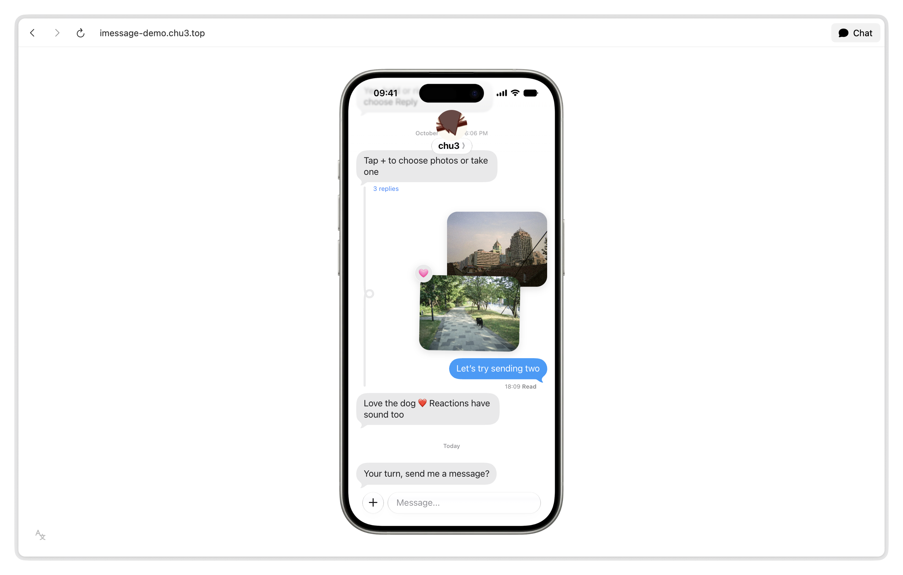

<p align="center">
  <picture>
    <source media="(prefers-color-scheme: dark)" srcset="public/apple-touch-icon-dark.png" />
    
  </picture>
</p>

<h1 align="center">iMessage demo</h1>

<p align="center">
  An iMessage interface and interaction demo built with React<br />
  English and Chinese, with light and dark modes that follow your system
</p>

<p align="center"><strong>English</strong> · <a href="README.zh-CN.md">简体中文</a></p>

<picture>
  <source media="(prefers-color-scheme: dark)" srcset="docs/preview-dark.png" />
  
</picture>

## Features

- Message sending, read receipts and typing indicators, with sounds for sending, receiving and reactions
- Hold or right-click a message to copy it, reply or view its thread
- Choose photos or use the camera from “+”, up to two at a time; reply to individual photos and see their reactions
- Glass surfaces and system light and dark modes; language follows your browser, with manual choices remembered via the bottom-left desktop control
- An iPhone frame on desktop and native page scrolling on smaller screens

## Run locally

Use Node.js 24 and pnpm 12.

```sh
pnpm install
pnpm dev
```

Open the local address shown in your terminal.

```sh
pnpm build    # Type-check and build to dist/
pnpm preview  # Preview the production build
```

Enter adds a new line. Ctrl / Command + Enter sends the message, or use the send button.

Messages and selected photos stay on the current page and are never uploaded. Refreshing the page resets them.

## Disclaimer

This project is for learning, interface research and non-commercial demonstrations. It is not affiliated with, endorsed or sponsored by Apple Inc.

Apple-related assets and data derived from system fonts belong to Apple Inc. or their respective owners. All rights reserved.

See [CREDITS](CREDITS.md) for asset sources and licenses.
