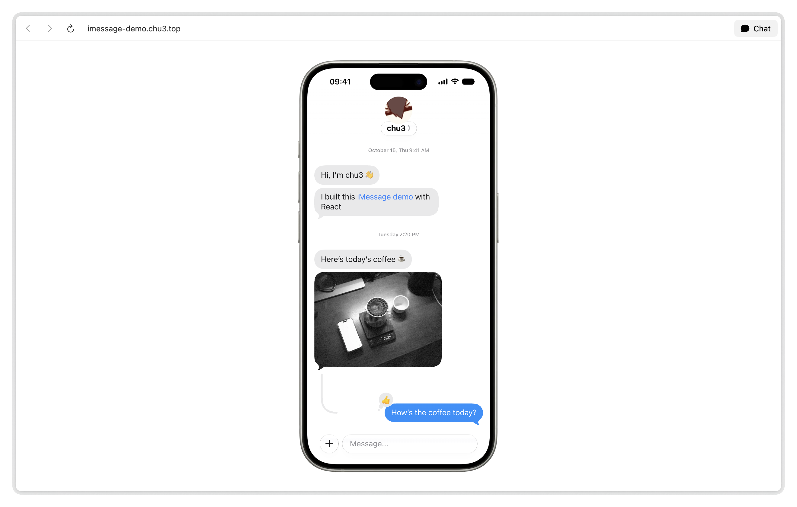

<p align="center">
  <picture>
    <source media="(prefers-color-scheme: dark)" srcset="public/apple-touch-icon-dark.png" />
    
  </picture>
</p>

<h1 align="center">iMessage demo</h1>

<p align="center">
  An iMessage interface and interaction demo built with React<br />
  English and Chinese, with light and dark modes that follow your system
</p>

<p align="center"><strong>English</strong> · <a href="README.zh-CN.md">简体中文</a></p>

<a href="https://imessage-demo.chu3.top/">
  <picture>
    <source media="(prefers-color-scheme: dark)" srcset=".github/assets/preview-dark.webp" />
    
  </picture>
</a>

## Features

### Messages and reactions

- Animated message sending, read receipts and typing indicators
- Animated Tapback reactions, with sounds for sending, receiving and reactions

### Quotes and replies

- Hold or right-click to copy or reply to a message, and view replies in a thread
- Animated reply view transitions and connectors that curl into loops, adapting to text and photo heights

### Photos and appearance

- Choose photos or use the camera, up to two photos at a time, with replies and reactions on individual photos
- Glass surfaces with light and dark modes that follow your system; English and Chinese follow your browser, with manual choices remembered
- An iPhone frame on desktop and native page scrolling on smaller screens

## Run locally

Use Node.js 24 and pnpm 12.

```sh
pnpm install
pnpm dev
```

## License

Original code and documentation are licensed under [MIT](LICENSE).

Apple assets are copyright Apple Inc. and are not covered by the MIT License. See [CREDITS](CREDITS.md) for asset sources and third-party licenses.
